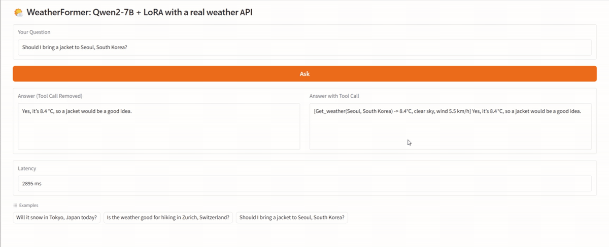
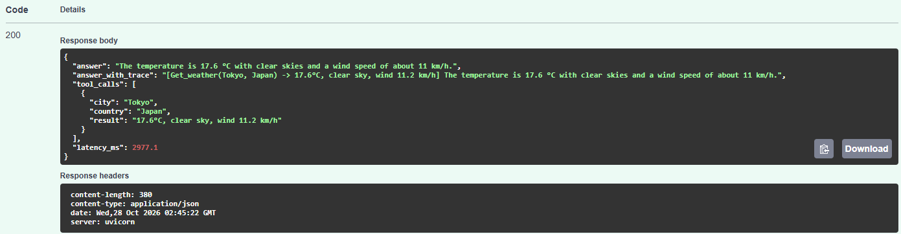

# 🌦️ WeatherFormer: Teaching an LLM to Call a Real Weather API

WeatherFormer applies the [Toolformer](https://arxiv.org/abs/2302.04761) recipe to **Qwen2-7B**: the model learns to emit `[Get_weather(City, Country)]` when a question needs live data, the server executes the call against [Open-Meteo](https://open-meteo.com/), and the model finishes its answer from the real result instead of guessing.

The project covers the full loop: synthetic data generation, self-supervised filtering, QLoRA fine-tuning, and a production-style serving stack (**vLLM + FastAPI + Docker**) benchmarked against the original Hugging Face inference loop.



## Architecture

```
Gradio UI ──► FastAPI (/v1/ask) ──► vLLM (Qwen2-7B + LoRA, or AWQ 4-bit)
                    │
                    └──► Open-Meteo (geocoding + current weather)
```

The agent loop lives in `weatherformer/agent.py`. vLLM generates until it hits `->` (the model just opened a tool call) or `\n` (end of answer). On `->`, FastAPI calls Open-Meteo, appends the result to the prompt, and generation resumes. Prefix caching in vLLM avoids re-processing the prompt after each tool call.

## Results

175 held-out questions (150 weather questions on 31 cities never seen in training, 25 unrelated questions), one RTX 3090. Latency is end to end through the API and **includes the live Open-Meteo call** (weather cache disabled for the benchmark).

| Configuration | p50 (s) | p95 (s) | req/s at 1 / 8 / 32 concurrent | GPU memory | Tool-call recall | Argument acc. | False-call rate |
|---|---|---|---|---|---|---|---|
| HF + 4-bit bitsandbytes (original loop) | 3.34 | 4.51 | 0.32 / – / – | 5.9 GB peak | 100% | 97.3% | 16% |
| vLLM 16-bit + LoRA | 1.40 | 1.89 | 0.75 / 5.8 / 11.5 | 14.6 GiB weights | 100% | 99.3–100% | 24% |
| vLLM AWQ 4-bit (merged LoRA) | **0.75** | **0.89** | 1.45 / 10.4 / **15.0** | **5.3 GiB** weights | 99.3% | 96.7% | 20% |

- **Latency:** AWQ on vLLM cuts p50 latency from 3.34 s to 0.75 s (4.5× faster) at one request at a time.
- **Throughput:** with 32 concurrent requests it serves 15 req/s versus 0.32 req/s for the original sequential loop (47×). At 32 concurrent requests, part of each request's latency is the Open-Meteo round trip, so the GPU is not the only bottleneck.
- **Memory:** AWQ cuts weight memory by 64% versus 16-bit (5.3 vs 14.6 GiB), with accuracy within 1–2 questions of the other configurations.
- **Weakness:** the model calls the tool on 16–24% of unrelated questions (4–6 out of 25). See Limitations.

Reproduce with `scripts/benchmark.py` (see "Benchmark" below). Per-question answers are written to `results/answers-*.jsonl`.

## Quick start (Docker)

Requires an NVIDIA GPU with ~24 GB, driver ≥ 580 (CUDA 13), Docker and the NVIDIA Container Toolkit.

```bash
cat > .env <<'ENV'
ADAPTER_ID=tamH123/weatherformer-qwen2-7b-lora
HF_TOKEN=
GPU_ID=0
ENV

docker compose up -d --build        # vLLM + API + UI
open http://localhost:7860          # Gradio UI
```

AWQ variant (after running `scripts/merge_lora.py` and `scripts/quantize_awq.py`):

```bash
docker compose -f docker-compose.yml -f docker-compose.awq.yml up -d
```

## API

```bash
curl -s localhost:8080/v1/ask -H 'Content-Type: application/json' \
  -d '{"question": "What is the weather like in Tokyo, Japan right now?"}'
```

```json
{
  "answer": "The temperature is 17.6 °C with clear skies and a wind speed of about 11 km/h.",
  "answer_with_trace": "[Get_weather(Tokyo, Japan) -> 17.6°C, clear sky, wind 11.2 km/h] The temperature is 17.6 °C with clear skies and a wind speed of about 11 km/h.",
  "tool_calls": [{"city": "Tokyo", "country": "Japan", "result": "17.6°C, clear sky, wind 11.2 km/h"}],
  "latency_ms": 2977.1
}
```

Interactive docs at `http://localhost:8080/docs`. `GET /health` returns 503 until vLLM is ready.



## Local development

Dependencies are managed with [uv](https://docs.astral.sh/uv/) dependency groups. Training and serving pin different torch versions, so they live in separate environments:

```bash
uv sync --frozen --group dev --group ui                                    # API, UI, tests
UV_PROJECT_ENVIRONMENT=.venv-train uv sync --frozen --group train          # fine-tune, merge, AWQ
UV_PROJECT_ENVIRONMENT=.venv-serve uv sync --frozen --group serve          # vLLM outside Docker

source .venv/bin/activate && ruff check . && pytest -q
```

## Training pipeline

1. `create_datasets.py`: generate questions with tool calls filled in from real Open-Meteo results.
2. `filter_toolformer_qwen.py`: keep only samples where inserting the call and its result lowers the model's weighted loss on the following tokens by at least a threshold, compared with no call or a call without its result (Toolformer filtering). 4,120 samples remain (`data/filtered_data.txt`).
3. `finetune_qwen2_peft.py`: QLoRA on Qwen2-7B (4-bit NF4 base, LoRA r=64, α=16 on `q_proj`/`v_proj`, lr 2e-4, 3 epochs, effective batch 8, max length 512). 20.2M trainable parameters (0.26% of 7.6B).

The adapter is on the Hugging Face Hub: [tamH123/weatherformer-qwen2-7b-lora](https://huggingface.co/tamH123/weatherformer-qwen2-7b-lora).

## Benchmark

```bash
# A: original HF loop
source .venv-train/bin/activate && python scripts/benchmark.py --name hf-bnb --hf
# B / C: through the API (start the matching docker compose stack first)
WEATHER_CACHE_TTL_S=0 docker compose up -d --build
source .venv/bin/activate && python scripts/benchmark.py --name vllm-lora --url http://localhost:8080 --concurrency 1 8 32
```

## Limitations

- Only current weather; no forecasts or history.
- Questions must name both city and country (`City, Country`), as in the training data.
- The model never learned to emit EOS (pad token = EOS during training), so generation stops on `\n`; answers are single-line.
- 16–24% false tool calls on unrelated questions: the training data contains almost no negative examples.
- In production the API caches Open-Meteo results for 10 minutes (`WEATHER_CACHE_TTL_S`), which makes repeated cities much faster than the benchmark numbers above.
